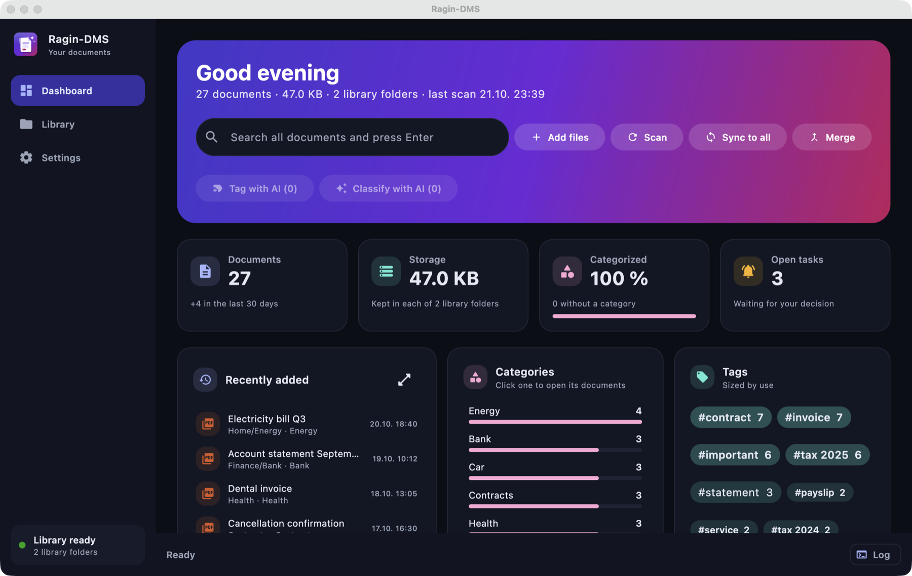

# ragin-dms

**A document management system for people who already have their folders in order.**

Most document management systems want you to set up Docker, run a database, and then import your
documents into their own storage, after which your files are only really usable through the DMS.
ragin-dms takes the opposite approach: it is a plain desktop app that works directly on the folders
you already have. There is no server, no database and no import. Your documents stay ordinary files
in your own directory structure, and you can keep using Finder, Explorer, your backup tool or your
cloud sync client exactly as before.

On top of those folders, ragin-dms lets you tag and categorize documents, search inside them, and keep
several copies of the library (for example a local folder plus iCloud or Proton Drive) in sync.
Categories and tags are stored in a small, readable file (`dms-catalog.yaml`) right next to your
documents, so nothing is hidden away and nothing is lost if you stop using the app.

To save you the typing, ragin-dms can suggest titles, categories, tags, dates and file names with
**your own local AI**, such as LM Studio or Ollama. Your documents are read on your machine and are
never sent to a cloud service. Every suggestion waits for your approval before anything changes.

Runs on macOS, Windows and Linux. Built with Rust and [Tauri](https://tauri.app); PDFs are read, rendered and
written with the bundled [PDFium](https://pdfium.googlesource.com/pdfium/) library. Optional: install
[OCRmyPDF](https://ocrmypdf.readthedocs.io) for precise OCR of scans.



<sub>The screenshot shows a demo library with invented documents, categories and tags.</sub>

## Why ragin-dms

* **No setup.** Install the app, choose your folder, done. No Docker, no database, no web server.
* **Your structure stays.** Files are never moved into a hidden store; the library is your directory tree.
* **Private by design.** AI runs on your own machine through any OpenAI-compatible local server.
* **Safe.** Nothing is overwritten silently, and nothing is deleted for good: files only go to the
  system trash, and only after you confirm.

## Features

### Your files stay yours

* The library is a plain directory tree. Every file manager, backup tool and sync client keeps
  working, and the library stays usable without the app.
* Categories, tags, titles, document dates and correspondents are stored in `dms-catalog.yaml` in the
  library root: human-readable, diffable, and copied into every library folder.
* Nothing is overwritten silently and nothing is deleted for good. Files only ever go to the system
  trash, and only after confirmation.

### Several library folders

* One primary folder plus any number of sync folders, each just a path (local disk, external disk,
  network share, or a folder that iCloud, Proton Drive or another client backs up). The app has no
  vendor-specific logic.
* Every change made in the app (add, rename, move, create folder, trash) is applied to all reachable
  folders. Operations for an offline folder are journaled and retried when it is back.
* **Sync to all** makes every sync folder match the primary; **Merge** copies every file that is missing
  anywhere into the folders that lack it. Neither deletes anything.
* Moved and renamed files are recognized by their SHA-256 hash. Paths are compared NFC-normalized, so
  macOS, Windows and Linux folders match.
* **Different names**: when a file has another name in one of the folders, one click renames it to match.
* Conflict copies of the catalog written by sync clients (`dms-catalog 2.yaml` and similar) are merged
  per document.

### Dashboard

* Everything that needs a decision is collected as an open task: new files, suggestions to review,
  files changed, moved or missing outside the app, different content in two folders, duplicates,
  catalog conflicts and failed operations. Open tasks show inline thumbnails.
* Statistics: documents, storage, how much is categorized, documents per year (click a year to open the
  library filtered to it), categories, tags sized by use, correspondents, and recently added documents.
* **Safe duplicate removal**: copies are only treated as duplicates when size, SHA-256 and a
  byte-by-byte comparison agree. The extra copies go to the trash in every folder, and their metadata
  is merged into the copy that is kept.

### Library

* Sidebar with collapsible trees for folders, categories and tags, and a year filter.
* List and grid layouts with thumbnails of PDFs and images.
* Drag and drop files from the file manager to add them, documents onto folders or categories to move
  or categorize them, and categories onto each other to restructure the category tree.
* Inspector with preview, metadata editor, tag editor with autocomplete, and "show in Finder/Explorer".
* Full-text search over the text of every document, including scans the AI has transcribed. The text
  is kept in the hidden `.dms-text/` folder of the library, together with the saved thumbnails.

### Local AI

* Works with any OpenAI-compatible server that needs no API key, such as LM Studio (the default, at
  `http://localhost:1234/v1`) or Ollama. As an alternative you can use Anthropic's Claude; its API key is
  read from the `ANTHROPIC_API_KEY` environment variable and never saved. Other providers that need an API
  key are not supported. The settings list the loaded models and have a connection test.
* PDFs are read from their text layer, or rendered and sent to a vision model when there is none (or
  always, with **Read PDFs as images**). Images go to the vision model, and the text of Word, PowerPoint
  and Excel files is read directly.
* Suggestions for title, category, tags, document date, correspondent and file name. The naming
  convention is learned from the existing file names of the library.
* Every suggestion is reviewed before anything is written: edit any field, pick an existing category
  or create a new one. Renaming to the suggested file name is opt-in.
* **Classify with AI** and **Tag with AI** process all new or untagged documents in the background.
* Ask questions about a document in a chat, or let the AI summarize it.

## Modules

ragin-dms is a Cargo workspace with one crate per layer, so the compiler enforces the dependency direction.

| Crate | Purpose |
|---|---|
| `crates/domain` (`dms-domain`) | Entities and domain rules. No I/O. |
| `crates/application` (`dms-application`) | Use cases and the ports (traits) they need. |
| `crates/infra-storage` (`dms-infra-storage`) | File system, catalog file, synchronization of the library folders, local state. |
| `crates/infra-ai` (`dms-infra-ai`) | OpenAI-compatible and Anthropic LLM client, prompts, embeddings. |
| `crates/infra-pdf` (`dms-infra-pdf`) | PDFium and lopdf: reading PDFs, images and Office files, previews, page tools, text layers, metadata, installed OCR. |
| `src-tauri` (`ragin-dms-desktop`) | Tauri shell and composition root: commands, presenters, session, menu, preview protocol. |
| `ui` | React + TypeScript webview (Vite, TanStack Query). It only renders; the logic stays in Rust. |

Dependencies point inwards only: `src-tauri` → `dms-application` → `dms-domain`; the adapters
`dms-infra-storage`, `dms-infra-ai` and `dms-infra-pdf` implement ports of `dms-application` and never depend on
each other. Only `src-tauri` knows the adapters.

The app keeps the state of each device (library folder paths, AI settings, open tasks, activity log,
scan caches) outside the library, in `~/Library/Application Support/ragin-dms` on macOS, `%APPDATA%\ragin-dms`
on Windows and `$XDG_DATA_HOME/ragin-dms` (default `~/.local/share/ragin-dms`) on Linux. These are the same
files as in version 1.x.

## Build

Requires:

* Rust stable (1.91 or newer) via [rustup](https://rustup.rs).
* Node.js LTS with npm.
* The platform build tools for Tauri (Xcode command line tools, WebView2 and MSVC, or `webkit2gtk-4.1`); see
  the [Tauri prerequisites](https://tauri.app/start/prerequisites/).

```bash
scripts/fetch-pdfium.sh                  # once: the pinned PDFium library into vendor/pdfium/
npm install && npm --prefix ui install   # once
npm run dev                              # app with hot reload of the UI
npm run build                            # installer in target/release/bundle/
```

`RAGIN_DMS_DATA_DIR=/some/folder npm run dev` starts the app with another settings folder, so you can try it on
a test library without touching your real settings.

Checks, as CI runs them:

```bash
cargo test --workspace
cargo clippy --workspace --all-targets -- -D warnings
cargo fmt --all --check
npm --prefix ui run typecheck && npm --prefix ui test
```

The TypeScript bindings in `ui/src/ipc/bindings.ts` are generated from the Rust commands; regenerate them with
`UPDATE_BINDINGS=1 cargo test -p ragin-dms-desktop export_bindings`. Shared IntelliJ run configurations are in
`.run/`.

On macOS, `npm run build` fails with "xattr -r not recognized" when a Python `xattr` shadows the system tool.
Put `/usr/bin` first: `PATH=/usr/bin:$PATH npm run build`.

## AI instructions

Instructions for AI coding assistants live in `.ai/` (entry points: `AGENTS.md`, `CLAUDE.md`).
